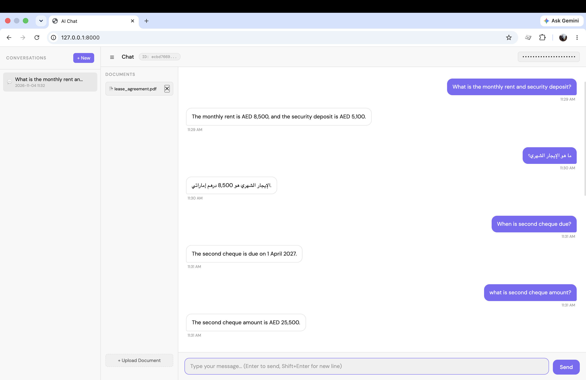
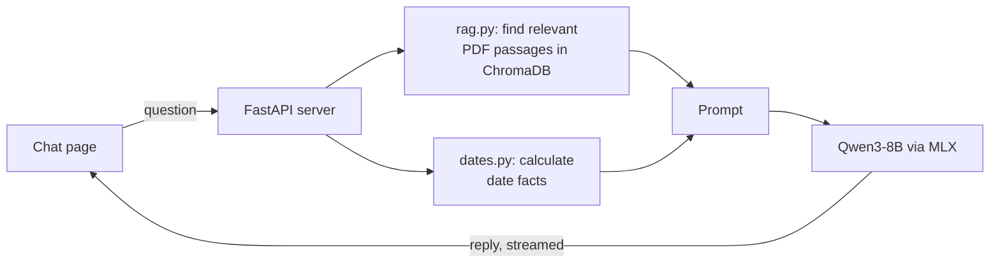

# Local AI Assistant

A private AI assistant that runs **entirely on your own Mac**: no cloud APIs,
so conversations and documents never leave your computer.



## Features

- **Private by design**: the language model runs locally and works with Wi-Fi off
- **Chat in English and Arabic**
- **Ask questions about your PDFs**: upload a document and get answers taken from it (RAG)
- **Accurate dates**: date questions are calculated in Python, not guessed by the model
- **Streaming replies**, word by word, with saved conversation history
- **Separate clients by API key**; replies are sanitized before they are displayed

## How it works



| Part | Technology |
|---|---|
| Language model | Qwen3-8B (4-bit), run with Apple's MLX |
| Document search | sentence-transformers (all-MiniLM-L6-v2) + ChromaDB |
| PDF reading | PyMuPDF |
| API | FastAPI with streaming (Server-Sent Events) |
| Front end | HTML, CSS, JavaScript; DOMPurify for safe rendering |

## Run it

Requirements: an Apple Silicon Mac (M1–M4, 16 GB memory recommended) and Python 3.11+.

```bash
git clone https://github.com/tariq-mumtaz/local-ai-assistant.git
cd local-ai-assistant
python3 -m venv .venv
source .venv/bin/activate
pip install -r requirements.txt
cp .env.example .env          # then set your own API_KEYS in .env
uvicorn api:app --host 127.0.0.1 --port 8000
```

Open http://localhost:8000 and enter one of your API keys.
The first start downloads the models (about 5 GB).

## Configuration

Settings live in `.env` (see `.env.example`). The assistant's instructions live in
`prompts/system_prompt.txt` and can be edited without restarting the server.

| Setting | Purpose |
|---|---|
| `API_KEYS` | Allowed keys, e.g. `key1:Tariq,key2:Client One` (required) |
| `MODEL_NAME` | Any MLX model from Hugging Face |
| `SYSTEM_PROMPT_FILE` | Use a different prompt file |
| `RAG_MAX_DISTANCE` | How closely a passage must match a question to be used (default 0.8) |
| `RAG_CHUNK_WORDS` / `RAG_CHUNK_OVERLAP` | Document chunk size and overlap in words (default 150 / 30) |

## Status and roadmap

Work in progress. Currently runs on Apple Silicon Macs only.

Next:

- Multilingual document search, so Arabic questions find answers in English documents (and the reverse)
- Windows and Linux support, including company servers
- Better answers to whole-document questions such as "summarize this document"
- A "show reasoning" option
- Automated tests

## License

AGPL-3.0, see [LICENSE](LICENSE). For a commercial license, contact me.